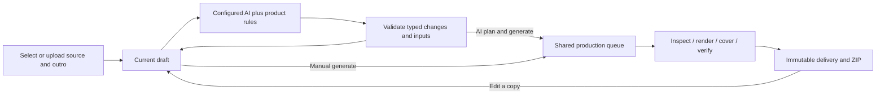

# Video production: product workflow

The **Video production** workspace packages an existing product clip. Its three
views are Product packaging, Media library, and Deliveries. This is the first
working slice of the media-workbench integration, not the completed three-line
editor.

## Use the workspace

1. Upload or select a product video and a finished brand-outro video. Both have
   inline previews. Uploads are limited to 2 GiB per file; matching content is
   stored once. Preview support depends on the browser's codecs.
2. Choose General product or Electric round table rules. These are declarative
   content rules, not separate models. Customer names and claims are user input.
3. Enter opening, cover and publication titles, an optional brand label, and
   a cover-frame time. The frame comes from the original product clip.
4. Choose a subtitle strategy:
   - **Keep existing subtitles** retains burned-in text and burns the first
     readable embedded text subtitle track into the export.
   - **No new subtitles** adds no subtitle overlay and drops soft subtitle
     tracks. Text already in the source pixels remains visible.
   - **Import SRT / VTT** uses supplied timestamps. It does not invent speech,
     guess timings, translate, or automatically run ASR. Correct malformed
     cues before submission. Valid overlapping timings are retained. Bitmap subtitle tracks need an
     imported text transcript.
5. Generate. Closing the browser does not stop queued work. Tasks expose actual
   inspect, render, cover and verify steps, plus cancellation and retry.
6. Preview the result in Deliveries and download a ZIP with the video, 3:4
   cover, publication title, and cover-title Markdown file.

Changing the product clears its old imported captions, cover time and titles.
The brand outro and label can be reused. This browser stores the current draft;
the backend stores submitted plans and jobs. Editing a finished task opens a
copy in the form and leaves the previous delivery intact.

## In-app AI

Configure a provider under **Settings → Models → LLM**, then enable/route
**Production AI** in LLM Skills. It uses the existing provider and encrypted
credential settings, including DeepSeek or another compatible configured model.
There is no second credential form, model download, chat server or GPU model.

- **Draft with AI** updates the current editable plan without creating a job.
- **AI plan and generate** validates the suggested plan and submits through
  exactly the same queue as the manual Generate button.

The request sends selected filenames, metadata, the draft, supplied subtitles
and the instruction. It sends no source audio, video or extracted frames. The
model has **not viewed the video**: it cannot identify unseen product features
or choose the most attractive frame from a filename. Supply confirmed facts,
review generated copy, and use a known cover time.

AI can change the three titles, brand label and cover time. It cannot switch
assets, rewrite subtitle timings, change frame rates or execute commands.
Invalid output or missing inputs are reported instead of being silently
replaced with marketing copy. A numeric consistency check rejects newly
introduced numbers; it is not proof of a claim. Disabled/unconfigured AI leaves
manual production available. Opening the page only reads configuration.

To keep the first version simple, this uses Studio's existing LLM service
instead of adding OpenCode. OpenCode/tool-driven asset selection remains a
later adapter and is not required for this workflow.

## Rendering and storage

- FFmpeg/FFprobe use the existing media-tools resolver. No additional production
  dependency was added to the Python or JavaScript manifests.
- Output is 1080×1920, 30 fps, H.264 CRF 18, AAC stereo 48 kHz. Normalization
  preserves aspect ratio and pads instead of stretching.
- Opening text ends by five seconds; an optional brand label follows it. A
  separately normalized outro is appended without product overlays.
- Covers are 1080×1440. Fonts resolve on the host: Microsoft YaHei on Windows,
  Noto Sans CJK SC on Linux. Install an appropriate system font on WSL if CJK
  glyphs are missing; no commercial font is bundled.
- Initial rendering uses CPU encoding with two encoding/filter threads and one
  production task at a time. It does not use Student's VRAM or change the
  avatar workspace's native 25/optional 60 fps settings.
- FFmpeg streams frames; Python does not retain entire videos in memory.
  Work and deliveries stay under `DATA_DIR/production`. No source-library,
  media or model directory is removed.
- `media_assets` and `production_runs` are additive tables. Shared `jobs` owns
  task state. Submitted plans and rule-pack snapshots are frozen.
- Retry creates a new task and renders again. The shared startup sweep marks
  interrupted tasks failed after a server restart. Automatic step-level resume
  is **not implemented** in this slice.

## Verification and limits

Targeted checks cover real FFmpeg output for voiced/landscape/60 fps, silent,
short and embedded-subtitle inputs; clean outros; range preview; cover size;
ZIP downloads; cancellation; immutable plans; migration; and AI validation.
The actual provider SDK is exercised against a local deterministic HTTP
responder, including AI → queue → real render → download. Browser checks use
the same approach, without paid requests. These checks do not establish real
model copy quality, customer visual acceptance or local GPU inference quality.
The full application startup test still requires the normal speech environment
(including Torch); it is not replaced by the isolated production-router checks.

Talking-head A/B-roll editing, narration montage/TTS, automatic ASR/translation,
Hyperframes animation, bulk planning, installable plugins and automatic restart
recovery remain outside this first product slice. Existing TTS and avatar
workspaces continue through their current integrations.
