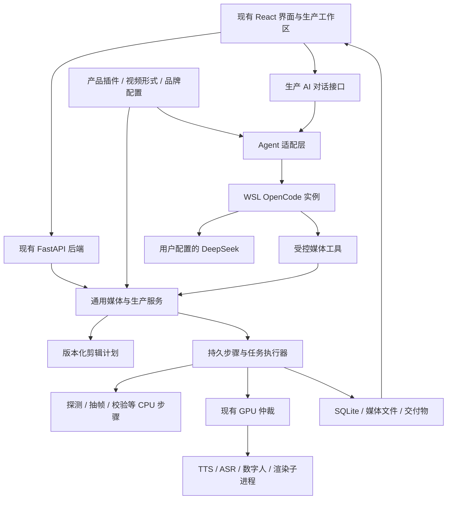

# VoxForma 自动剪辑、素材库与 AI 插件集成方案

日期：2026-11-06。状态：**待用户审核，尚未开发功能**。

目标项目：`D:\prijects\zhilian-VoxForma`。
参考源库：`D:\prijects\电动圆桌自动剪辑库`。

本方案依据用户提供的三条生产线说明，以及两个项目的实际代码制定。引用的旧文档、示例和脚本是待迁移资料，不代表其中的行为已经正确实现，也不直接成为新 App 的运行权限。

## 1. 建议先确定的方向

在现有 VoxForma 中增加一个“视频生产”工作区，集成素材库、自动剪辑、AI 操作、任务和成品管理。继续使用现有 Electron/React 浏览器界面、FastAPI 后端、SQLite、语音引擎及数字人能力，不另外开发一套独立 App 和业务服务器。

拆成三层：

1. **通用媒体核心**：管理素材、转写、镜头、字幕、封面、混音、渲染、任务和交付物；按钮与 AI 调用同一组服务。
2. **产品插件与视频形式**：保存行业知识、选材规则、工作流、模板和校验规则。电动圆桌是第一个插件，核心不写死“龙厂、机芯、包间”。
3. **品牌/客户配置**：人物、Logo、贴纸、片尾、声音、已确认卖点、默认风格。换同类产品客户时通常只换这层。

AI 首版建议采用 **OpenCode 服务适配器 + DeepSeek**。不同时接入两个 Agent 框架，不照搬另一个完整聊天产品的页面。OpenCode 只负责会话、理解、规划和调用受控工具；VoxForma 后台负责持久任务和实际执行。

实施顺序：先做产品线的可验证闭环，再接 AI 与插件管理，最后让口播线、配音线复用同一套服务。三条线都在完整目标内，分阶段不代表取消后两条。

## 2. 操作前的 Git 回滚点

| 项目 | 本次已完成的操作 | 回滚基线 |
| --- | --- | --- |
| VoxForma | 拉取并核对 `origin/main`；建立本地备份标签；切到方案分支 | `c30da0de63c98410bc546ee90736b729d7a84771` |
| 电动圆桌剪辑库 | 实际没有 `.git`，已初始化本地仓库，保存原始代码、文档与受版本管理的资源 | `86fd3f7` |

- VoxForma 标签：`backup/pre-media-integration-20261106`。
- 源库标签：`backup/pre-voxforma-integration-20261106`。
- VoxForma 方案分支：`plan/media-workbench-integration-20261106`。
- 源库没有配置远程地址，本次不把它上传到公开仓库。
- Git 快照不包含已忽略的媒体、运行环境和 RVM 模型；它不是这些大文件的完整备份。本次没有移动或删除它们。
- 本轮只提交方案及相应文档检查配置，不修改生产逻辑、不安装依赖或模型、不调用付费 AI、不改服务器服务。

审核通过后，功能在独立分支逐步实现，不直接在 `main` 或当前服务器安装目录中开发。

## 3. 实际代码核对：可以复用什么，不能直接搬什么

### 3.1 源剪辑库

| 已核对的位置 | 当前事实 | 集成处理 |
| --- | --- | --- |
| `4_engine/tools/build-html.mjs` | 能从 manifest 与骨架生成 HTML，已有样式和时间护栏，但部分问题仅警告；允许 `extraHtml/extraJs/extraCss` 直接注入 | 保留生成器和模板，通过适配器接入；App 的公共计划不接受任意脚本，执行前另做强校验 |
| `batch_product_runner_turbo.py:159–177, 577–601` | 虽开启 `word_timestamps=True`，切字幕实际按清洗后字数比例分配时间，没有采用逐词时码 | 重写字幕对齐适配，不把比例均分逻辑作为通用能力 |
| `batch_product_runner_turbo.py` 的 `plan_copywriting()` / `translate_en()` | 存在固定数字卖点、关键词套文案、固定翻译兜底 | 不作为 AI 内容规划器移植；标题、翻译、数字都必须有来源 |
| `batch_product_runner_turbo.py:559–583` | 直接拉伸到 `1080:1920`，直接转写，没有实现流程文档完整的字幕轨/硬字幕/无声判断 | 先媒体探测与字幕策略，再归一化、转写 |
| Turbo 渲染和并发入口 | 写死 Windows Chrome/Git Bash、`npx.cmd`，默认三个渲染进程 | 改为运行时发现和独立渲染 Worker，首版一个 GPU 重任务并发 |
| `batch_koubo_pipeline.py` | `VIDEOS_CONFIG` 带固定视频配置；Windows Python、Chrome 和某台机器的 Hyperframes 缓存路径写死 | 拆解能力，不把该批处理文件直接作为通用入口 |
| 口播脚本 Python 语法 | 本机 Python 3.11 静态解析在含反斜杠的 f-string 处失败 | 移植时改为兼容主环境的写法；不原样接入后端 |
| `run_asr.py` | 输出逐词时间，默认 CPU/int8；与 Turbo 的 CUDA 运行方式不同 | 统一为现有 ASR 服务的能力适配，不复制两套模型管理 |
| `select-assets.sh` / `mark-used.sh` | 基于文件索引选择和登记素材 | 导入已有索引，转为数据库服务；使用次数由正式交付事务更新 |
| 混音、拼版、封面、片尾、验收工具 | 有可复用实现，但绑定目录布局与若干业务假设 | 参数化，按单个步骤包装，保留可追踪日志 |
| 批处理末尾的清理 | 有直接删除工作目录的行为 | 改成后台可配置清理；未交付、失败和待返修工程默认保留 |

**当前提供的目录副本不含** `.asr-venv`、`.asr-models`、`1_assets`、`2_stickers`、`3_brand`，也没有品牌片尾池。RVM 文件存在，但不在 Git 中。文档中的“工具/素材全自带”不能当成这份副本的环境事实。

所以可以迁移规则和工具，但目前不能仅凭复制目录就验收真实四件套。第一阶段必须做资源准备检查，缺少必需片尾等资源时在提交前明确提示。

### 3.2 VoxForma

| 现有能力 | 已核对的代码 | 使用方式 |
| --- | --- | --- |
| TTS、音色、情绪、模型设置 | 现有 generation / TTS backend / model manager | 配音线复用；一次生成整段最终配音，按实际音频对齐 |
| 数字人和形象库 | `backend/integrations/avatar/` | 数字人成片可以作为口播线输入，不另造形象和音色系统 |
| GPU 协调 | `avatar/gpu_scheduler.py`、`services/avatar_gpu.py`、`services/gpu_gateway.py` | GPU 步骤接入同一协调链，普通启动仍保持可选 |
| 任务和事件持久化 | `core/job_store.py`、`core/db.py` 的 `jobs/job_events` | 复用任务 ID、事件和状态；补步骤级执行记录 |
| 运行队列 | `core/job_queue.py` | 当前队列/函数仍在内存中，重启恢复不能只靠复用该文件 |
| 项目记录 | `studio_projects`、`api/routers/projects.py` | 复用统一项目身份，新增生产工程明细和打开方式，不覆盖旧项目内容 |
| LLM 供应商/密钥/功能路由 | `services/llm_providers.py`、`llm_transport.py`、`llm_skills.py` | 沿用设置和凭证管理，增加剪辑用途及视觉能力检查 |
| 可视化工作流 | `features/workflows/workflow-model.ts` | 当前定义保存在浏览器 localStorage，不能当作后台持久渲染引擎；后续可增加“视频生产”高层节点 |
| CLI Agent 适配 | `services/llm_cli.py` | 依赖正在运行的 Electron 桌面；不能假设搬到 WSL 浏览器部署后即可直接用于后台 AI |

关键结论：现有框架能复用很多基础设施，但**任务记录存在不等于任务可跨重启续跑，已有 LLM 文本请求也不等于已有媒体 Agent 工具循环**。这两项需要明确开发。

## 4. 最终用户怎么使用

### 4.1 工作区与页面

建议左侧增加“视频生产”分组，包含：

| 页面 | 用户能做什么 |
| --- | --- |
| 生产工作台 | 选项目、产品插件、品牌、生产线；上传/选输入；手动配置或与 AI 对话；一键生成 |
| 素材库 | 上传、目录扫描、缩略图、试听、标签、场景、人物、检索、重复识别、使用记录与恢复 |
| 工程详情 | 查看计划、镜头顺序、字幕时码、包装、配音、片尾、封面；修改后创建新版本 |
| 任务中心 | 看真实步骤、队列位置、进度、缺少资源、取消、失败原因及重试 |
| 成品库 | 视频预览、封面、发布标题、版本、四件套下载与归档 |
| 插件与品牌 | 安装/启用产品规则包、选择模板、维护品牌和人物配置、查看缺少资源 |

继续使用 VoiceStudio 的音色选择器、模型页、设置布局、播放器和国际化，不重做它们。第一版不做专业 NLE 的逐帧多轨拖拽编辑器；先提供镜头/字幕列表和局部替换，数据结构保留时间线扩展能力。

### 4.2 一个完整例子

用户在素材库选中一批产品视频，进入工作台选择“电动圆桌 → 产品展示 → 某品牌”，点击自动生成或告诉 AI：“每条加标题，保留已有字幕，接这个品牌的片尾”。

1. 后台记录选中素材的 ID，而不是把文件路径和整库内容塞进模型。
2. 探测视频，检查资源，识别字幕/人声情况。
3. 加载该工作流的规则，生成带证据的计划。
4. 服务校验计划后按用户选择的模式执行。
5. 每条任务独立生成画面、包装、声音、片尾、封面和标题。
6. 验收通过后，在成品库出现完整四件套；失败项能单独重试。

提供两种模式：“自动生成”和“先审阅计划”。自动模式对已配置完整的项目直接执行，不逐步骤反复弹确认；缺必需资源、未经确认的卖点或不可执行计划时，显示具体待补内容。

## 5. 系统结构与边界



- FastAPI 仍是唯一业务入口和授权边界，不新增第二套 Node 业务数据库或任务队列。
- Python 管业务服务和长任务；FFmpeg、Node/Hyperframes、OpenCode 是受管理子进程/适配器。
- 生产任务由后台拥有，AI 会话关闭不能导致已提交任务消失。
- App 和 AI 共用相同的校验、配额、版本冲突与任务接口，AI 不能跳过它们直接修改数据库。
- 本机开发代码；真实重渲染、语音与数字人生成在 5080 的 WSL 环境验收。
- 首版重媒体执行明确支持 Linux/WSL。其他平台可使用已有界面及远程后端；不把尚未验证的平台写成已经支持。

## 6. 素材、工程与交付数据

### 6.1 素材库

视频、音频、图片、品牌片尾、Logo、贴纸、BGM、音效统一用 `asset_id` 管理，但保留各自类型、用途和权限。人物形象仍有独立业务模块，通过关联引用连接素材，不重复复制大视频。

导入策略：

- 浏览器上传：复制到后端托管目录，支持进度、失败重试和上限检查。
- 后端已有目录：由管理员配置根目录并扫描/选择；局域网浏览器不能传一个任意本机路径要求服务器读取。
- 既有素材索引 JSON/Markdown：做一次性导入，不继续让 SQLite、JSON 和 Markdown 三份都可任意写。
- SHA-256 标识相同内容；文件名与内容身份分开，允许同一素材有多个展示标签。
- 先上标签、关键词和 SQLite 检索；以后确有需要再增加语义向量，不先装一个向量库和新模型。
- ASR、OCR/视觉分析保存缓存，键包含素材哈希、工具/模型版本及参数。
- 人物、场景和行业词属于插件/项目标签，不写成核心数据库的固定列。

口播/配音线在**成功交付时**登记素材使用；产品线只用输入片不计 B-roll 使用次数。候选搜索、抽帧、失败渲染、重试同一次交付不重复计数。重做封面不增加素材使用次数；新交付版本是否计新一次使用由明确策略决定。

### 6.2 持久化边界

沿用现有 SQLite 与 Alembic，新增独立生产表，避免把大量不透明状态塞进原项目 `state_json`：

| 数据 | 建议表/记录 | 核心信息 |
| --- | --- | --- |
| 素材 | `media_assets`、`media_asset_locations` | 哈希、位置、元数据、托管方式、软删除 |
| 分析 | `media_analyses` | ASR/镜头/视觉结果与版本 |
| 生产工程 | `production_projects` | 关联统一项目 ID、工作流、品牌及当前版本 |
| 计划 | `production_plans` | 不可变 revision、输入、镜头/字幕/封面、校验结果 |
| 执行 | `production_runs`、`production_steps` | 关联现有 job ID、状态、输入指纹、产物与尝试次数 |
| 交付 | `production_deliveries`、`production_artifacts` | 四件套、验收、版本、发布标题 |
| 使用记录 | `media_usages` | 交付与素材的唯一关联、使用区间 |
| 定制 | `production_plugins`、品牌配置记录 | 版本、依赖、可用模板、资源绑定 |

表名为实施建议，不是已经创建的表。统一项目列表需要识别生产工程的打开方式；旧语音/译配工程继续沿用原行为，不把它们的旧状态覆写为新格式。

媒体在普通文件目录，数据库只保存索引与关系。默认建议存于配置的数据盘，通过 App 设置目录；不把客户文件放在 Git checkout、容器系统临时层或模板目录里。

## 7. 核心中间件：剪辑计划

保留 `base.mp4 + manifest.json` 的价值，但把现有 manifest 定位成**渲染适配器输入**。新系统的主工程格式为 `EditPlan v1`，不能只保存最终 HTML。

计划至少包含：

- `schema_version`、`project_id`、`revision`、父版本、创建者；
- 插件、工作流、模板、品牌配置的 ID、版本及内容哈希；
- 输入资产、素材版本和文件哈希；
- 输出规格、裁切/填充策略和编码配置；
- 每个镜头的素材 ID、源区间、成片区间、画面处理与音频策略；
- 最终配音资产、逐词对齐结果与字幕分段；
- 开场、贴纸、重点字、音效、BGM 和音量；
- 独立片尾选择及其哈希；
- 封面来源资产、时间点、候选、版式与标题；
- 事实引用：原稿段落、转写词区间或已确认的品牌卖点；
- 随机种子、验证结果和需要补充的资源。

不在公共计划中放命令行、任意文件路径、Python/JS 源码或任意 HTML。`b/em` 等少量文字强调由受控富文本节点表达；可信模板负责转换为 HTML。

### 7.1 时间与内容原则

1. 保存源时间和成片时间的映射；口播裁切、调序后，字幕和声音按同一映射转换。
2. 用毫秒/帧号及有理数帧率表达边界，避免只靠两位小数累计误差。
3. 有文稿时，字幕文字以校正后的文稿为准，时码来自最终音频的逐词识别/强制对齐。不得按字符数估算。
4. 最终配音变了就使相关对齐失效；只换封面不使转写、画面和声音失效。
5. 翻译对应中文时间段，忠于原意；不能回落到一个泛化的固定英文营销句。
6. 数字、材质、质保、价格等来自可核对证据；缺少数字时选择无数字版式，而不是套“3年、90%”模板。

### 7.2 程序校验与 AI 判断分工

程序强校验文件/版本存在、时间合法、镜头覆盖、字幕越界、资源齐全、模板能力和数字证据引用。长度不足五秒的视频不能仍硬套五秒后的大字区间。

AI 辅助判断镜头语义、开场是否忠实、构图和文字避让。AI 的“看起来通过”不能替代媒体解码和技术验收；程序检查通过也不等于内容质量已经通过。

计划进入执行前冻结为一个 revision。修改产生新版本；界面和 AI 修改都携带预期 revision，防止旧对话覆盖新安排。

## 8. 三条生产线如何接入

### 8.1 产品获客线：第一条闭环

输入：已有产品视频、可选文稿/卖点、品牌配置。**不要求用户先配 TTS，也不生成产品主体视频。**

步骤：输入探测 → 字幕/人声策略 → 保比例归一化 → 计划 → 标题与克制包装 → 独立混音 → 接品牌片尾 → 封面 → 验收 → 四件套交付。

- 硬字幕：保留源画面文字，不再叠跟声字幕。
- 软字幕轨：先提取/转换或明确保留方式，不能在转码时丢掉字幕轨后仍以“已有字幕”为由不显示字幕。
- 无字幕且有效人声：本地转写、逐词对齐后制作字幕。
- 无人声：不强行生成 ASR 字幕；可用输入标题/已确认卖点和少量文字。
- 横屏/方屏：默认等比例填充或带背景的适配，不能直接拉伸产品；裁切需预览完整主体。
- 主体不超过约五秒时：动态缩短开场/省略中段大字，不生成负时长和相互挤压的包装。
- 品牌片尾若在该配置中为必需，没有可用片尾就提前报缺资源；不能默默交一个缺片尾的“成功”成品。
- 片尾在正片完成后连接，不进入正片 manifest，不叠加其字幕、贴纸或音效。随机选择结果冻结，重试不重新抽一个。

### 8.2 口播人设线

输入：真人讲话视频，或已有数字人成片；可选原稿、出镜人和辅助素材。

步骤：探测 → 本地 ASR/对齐 → 分析主观点与证据 → 选择 A-roll/B-roll → 生成镜头计划 → 合成 base → 包装混音 → 人物封面 → 验收交付。

表达立场、最强判断优先保留人物；解释结构、生产、交付时插证据画面。缺少合适 B-roll 就保留人物，不用无关镜头凑数。B-roll 默认静音，由人物原声贯穿；必要剪切的声音与源时间映射一致。

出镜人由明确选择、文件名前缀或已保存归属确定，不靠猜声音。名牌按人，贴纸按内容。封面底图必须来自原人物 A-roll；穿人等效果为可选能力，人物姿态不适合时采用普通标题形式。

TBDub 的原生 25fps / 可选 RIFE 60fps 保持现状，不把新剪辑插件默认 30fps 改成数字人的模型帧率。数字人成片进入剪辑时间线后，按该工程的目标规格进行明确的时间转换。

### 8.3 配音场景线

输入：录制/已生成的音频，或文稿与 VoiceStudio 音色；可选情绪参考。

步骤：复用 TTS 生成并保存整段最终配音 → 退出/释放语音模型 → 本地对齐 → 按语义选画面 → 铺满音频时间线 → 字幕混音 → 场景封面 → 验收交付。

不默认逐句反复 TTS。已生成的配音保存为可复用资产，后续换镜头、换封面不重新配音。

画面优先级：精确场景 → 相关空镜 → 经校验的文字卡。素材不足时 App 显示缺哪些场景；不能无限循环少数素材、静默黑屏或在声音讲机芯时全程展示不相关展厅。BGM 为可选低音量配置。

### 8.4 共用交付

电动圆桌插件默认视频 `1080×1920 / 30fps`，封面 `1080×1440`；这是该插件的输出配置，不是强改 VoxForma 全局规格。

四件套：`片名_成片.mp4`、`片名_封面.jpg`、`片名_发布标题.txt`、`片名_封面图标题.md`。数据库和可恢复工程文件保存在另外的内部目录，用户交付目录只呈现四件套。

技术验收检查真实流时长、帧率/画幅、可解码、声音是否被截断、片尾是否完整、封面尺寸和文件齐全。纯静音输入应按所选声音策略验收，不盲目套旧脚本“末段必须有声”的规则。

## 9. 插件、Skills 与品牌配置

建议业务包结构：

```text
plugins/roundtable/
  plugin.json
  skills/                 # 内容理解、选材、字幕、封面等规则
  workflows/              # product / talking-head / narration
  templates/              # 可信视频和封面模板
  schemas/                # 配置与计划校验
  defaults/               # 行业默认值，不放客户私有资料
```

- **Skill** 告诉 AI 如何判断和使用工具；不是 Worker，也不负责执行状态持久化。
- **workflow** 声明步骤、输入输出、依赖和资源需求；只引用已注册 handler，不内嵌 shell 命令。
- **template** 是经过审查的渲染资产，记录版本和能力；AI 只填类型化数据。
- **brand profile** 放在用户数据目录，包含客户品牌、人物、音色、贴纸/片尾资产 ID 和已确认卖点。
- **plugin.json** 至少保存 ID、版本、最低核心 API 版本、工作流/模板入口、能力需求及资源声明。

首版插件默认为声明式业务包，不允许一个下载的 ZIP 自动获得 Python/Node 执行权限。确有行业专用算法时，再以审核后的 handler 扩展工具目录，不用任意 `tools/*.sh` 自动扫描执行。

安装插件只验证并登记规则、模板与资源声明；模型仍通过已有设置页显式安装。校验路径穿越、依赖、模板版本和内容哈希，升级旧包不改变已提交任务的版本快照。

电动圆桌首包可迁移原有行业规则和视觉形式。客户名字、实际卖点、照片/声音和成品片尾不随公开代码发布。现有字体、音效、图像与代码的分发清单需逐项记录来源，不能因文件在源目录中就认定可公开再分发。

## 10. AI 适配：首版 OpenCode，DeepSeek 可配置

### 10.1 为什么这样选

OpenCode 官方提供 HTTP Server、OpenAPI 与 JS/TS SDK，可通过独立进程供自己的 App 调用；Skills 与自定义工具已有明确接入方式。这里利用它的会话与工具循环，业务数据仍归 VoxForma。[Server](https://opencode.ai/docs/server/)、[SDK](https://opencode.ai/docs/sdk/)、[Skills](https://opencode.ai/docs/skills/)、[Custom Tools](https://opencode.ai/docs/custom-tools/)。

DeepSeek Harness 是另一种可行框架，但官方仍标为 developer preview，并明确提示会有兼容性破坏。本轮不同时维护两套；若以后替换，只换 AgentAdapter，不迁移素材/任务/计划数据。[官方仓库](https://github.com/deepseek-ai/deepseek-harness)。

以上为基于接口边界的选型建议，不代表已完成 OpenCode 与本项目的 SDK 联调。开发初期先做小型 PoC：会话、流式事件、一个只读工具、一个创建计划工具、取消和权限拒绝全部通过，再锁定具体版本。Hyperframes 初始兼容目标为源库的 `0.6.93`，两者均不得运行时无条件追 `latest`。

### 10.2 进程与权限

- OpenCode 实例按需在 WSL 启动，仅绑定 loopback，由 FastAPI 代理；不新增对外开放的 Agent 端口。
- 会话工作目录为受控生产工程目录，不是源码仓库，也不自动读取开发者机器的全局 Skills/配置。
- 默认禁止通用 shell、源码编辑、任意文件读取及无关网络访问，只开放已注册媒体工具和选定 Skills；配置与实际拒绝行为都要在 PoC 验证。OpenCode 提供 allow/ask/deny 权限配置，但配置能力不等于已经达成本项目的隔离要求。[Permissions](https://opencode.ai/docs/permissions/)。
- DeepSeek 密钥复用现有供应商/加密凭证体系，不写进插件、计划、浏览器存储、日志或 Git；不借用别人的 `vision.js` 内置密钥。
- 文本规划与视觉选择分别选择模型/能力。当前 DeepSeek 官方说明 `deepseek-flash` 接受图片；不能据此认为任意用户选择的模型或兼容中转都支持视觉，需运行能力检查。[Vision](https://api-docs.deepseek.com/guides/vision/)。
- 原音频/整条视频默认不传云端，本地 ASR 保持。用户开启云端 AI 后，按任务发送所需文本和候选帧；设置中明确这两种发送行为。

### 10.3 一套工具，两种操作入口

首批受控工具建议：

| 能力 | 工具示例 | 返回结果 |
| --- | --- | --- |
| 项目与规则 | `project.get_context`、`plugin.get_rules` | 当前选择、版本、工作流约束 |
| 素材 | `asset.search`、`asset.get`、`asset.analyze` | 少量候选、元数据、可查看缩略图 |
| 配音/对齐 | `speech.create`、`transcript.align` | 任务 ID / 最终音频 ID / 对齐版本 |
| 计划 | `plan.create`、`plan.update`、`plan.validate` | 新 revision、错误和证据引用 |
| 执行 | `production.submit`、`job.get`、`job.cancel` | 后台任务 ID、真实状态 |
| 交付 | `delivery.list`、`delivery.create_revision` | 四件套、版本、返修入口 |

API 与工具定义从同一组类型化服务生成/适配，AI 工具不拼接 shell。模型不能直接提交一个未校验的 `render` 命令。界面选中的素材 ID、工程版本和当前交付 ID 会进入会话上下文，避免“换第三个镜头”作用到别的工程。

只调整封面、字幕或镜头时，修改计划并重新执行受影响节点，不靠 AI 随口声称“已完成”。App 的任务/产物记录才是完成依据。

## 11. 后台步骤、恢复和 GPU 调度

### 11.1 持久执行

在现有 `jobs/job_events` 上增加 `production_runs/production_steps`，每个步骤保存：输入指纹、handler 版本、参数、插件/模板快照、输出哈希、状态、日志、尝试次数及进程所有者标识。

旧 `job_store` 会在重启时把进行中的任务标失败，这是准确的旧行为，不能在界面上把它包装成“已经支持恢复”。新生产任务需要单独的恢复协调：

1. 先确认旧进程/租约已经结束，不能仅凭心跳过期就重复启动 GPU 工作。
2. 重新检查成功步骤的输出及输入指纹。
3. 只复用匹配的完整产物，从第一个失效步骤继续。
4. 有资源缺失时进入待补状态，补齐后重新入队，不占着 Worker 等人工操作。
5. 不改旧任务状态枚举的含义；“待资源/待审核”作为生产子状态呈现。

缓存键至少包含输入内容、参数、工具/插件/模板版本和实际选中的片尾。相同请求使用幂等键，不因 RPA 双击或 SSE 重连提交两份。

交付时在事务中登记产物与素材使用。临时文件先写 `.partial`，成功后原子替换；不能出现数据库显示成功却缺封面/标题。完整验收后再发布交付版本。

### 11.2 资源预算

- 默认重 GPU 并发为一，不照搬 Turbo 三个 Chrome Worker。
- TTS、GPU ASR、TBDub、RIFE、GPU 渲染接同一仲裁；CPU 探测/规划不占 GPU。
- 每个 GPU 步骤申请/释放租约，不让整个长工作流拿着 GPU 等云端 AI 或人工审阅。
- NVENC/浏览器 GPU 渲染也占资源，不能因不是 PyTorch 就绕过预算。
- Student 的现有显存检查、2-step、流式 VAE/输出和 25/60 帧选项保持不变；新任务类型按自己的需求检查，不把 Student 阈值套到所有步骤。
- CPU 并发、内存、临时磁盘分别限额。实际读取目标机可用资源，不硬编码一个 WSL 内存上限，也不让 64GB 内存变成“可以无限读全视频”的理由。
- 视频按段/管道处理，不在 Python 列表里长期保存完整视频帧；任务开始前估算工作盘空间。
- 取消时终止本任务的子进程树并确认租约释放；保留可复用步骤，不能误杀其他服务的 FFmpeg、Chrome 或语音进程。

### 11.3 状态显示

提交、分析、规划、排队、转写、合成、混音、片尾、封面、验收和交付都有真实步骤状态。能取得帧进度时显示百分比，否则显示阶段和耗时；不伪造一路平滑增长的进度条。

浏览器关闭后后台继续；重连先读取当前快照，再接事件。事件裁剪后要有重新同步机制，不假设无限保留 SSE 历史。

## 12. 建议代码位置与兼容方式

```text
backend/
  api/routers/production.py       # 生产、计划与任务接口
  api/routers/media_assets.py     # 素材库接口
  api/routers/production_plugins.py
  production/
    assets/ plans/ plugins/       # 通用服务与类型
    runners/ handlers/            # 持久步骤、工具适配
    agents/                       # OpenCode 适配，非业务数据库
    renderers/                    # HTML/Hyperframes、FFmpeg 适配
  migrations/versions/            # 增量迁移
electron/src/renderer/src/features/
  production/ media-library/ deliveries/
plugins/roundtable/               # 行业业务包
```

名称为拟定，不表示已经创建。源库不整目录复制到 `backend/services`：只迁移确定复用的工具、模板与规则，并记录原始版本、修改和资源来源。

公共接口建议以 `/production/*`、`/media-assets/*` 为独立命名空间，例如：

- `POST /media-assets/upload`、`GET /media-assets`、`GET /media-assets/{id}/preview`；
- `POST /production/projects`、`GET /production/projects/{id}`；
- `POST /production/plans`、`POST /production/plans/{id}/validate`；
- `POST /production/runs`、`GET /production/runs/{id}`、`POST /production/runs/{id}/cancel`；
- `GET /production/deliveries`、`GET /production/deliveries/{id}/download`；
- `GET /production/plugins`、`POST /production/ai/sessions`。

上述路径为设计草案，实施时与现有认证/原生路径能力接口对齐。范围下载、中文文件名和局域网上传需复用已有处理，不能又做一套不支持视频拖动的下载接口。

原有 TTS、译配、数字人、形象库和浏览器工作流继续使用。现有高层工作流以后通过一个生产节点引用 `workflow_id + plan_id`，而不是把持久任务反过来依附在浏览器 localStorage 上。

## 13. 分阶段开发与验收门槛

### 阶段 0：基线与准备（本轮）

Git 快照、能力盘点、差距、完整方案。本轮不渲染、不下载模型、不接入付费 API；审核后进入下一阶段。

### 阶段 1：打通受控产品线和 Agent 小型 PoC

- 先用结构化手动计划连接探测、归一化、生成器、混音、片尾、封面与验收。
- 补齐字词时码、无声/字幕策略、路径与运行时发现等明确缺口。
- 同时用少量测试工具验证 OpenCode 适配边界，不先做完整聊天系统。
- 资源完整的一条真实产品片交付四件套；缺片尾等必需资源时提交前提示。

这一阶段不以“旧脚本能执行”和“聊天能回复”作为验收通过。

### 阶段 2：App 的首个可用版本

- 完成素材导入/预览、生产工作台、计划详情、持久任务和成品四件套。
- 产品线按钮操作可完成全过程；中断与单条失败可恢复，不重复登记使用次数。
- 实测浏览器上传和下载，支持局域网操作；所有新 UI 文案按项目国际化规范维护。

### 阶段 3：正式 AI 与插件化

- OpenCode + DeepSeek 的工具循环接入相同服务，按需加载电动圆桌规则。
- 插件、视频形式、品牌分层配置；所有计划和运行保存版本快照。
- 能完成“这批片生成若干条”“只用选中的素材”“换第三个镜头”“封面换疑问式”等操作。
- 关闭 AI 后，手动工作台仍能工作；关闭对话后，已经提交的任务仍能完成。

### 阶段 4：口播与配音两线

- 通用口播规划替换固定 `VIDEOS_CONFIG`，正确处理 A-roll/B-roll 与原声。
- 配音线复用现有 TTS/音色及最终音频对齐，补齐整条画面覆盖。
- 数字人结果可作为口播素材，不修改原有模型参数与生成逻辑。

### 阶段 5：验证可扩展与发布安装

- 用一个业务明显不同的第二品类验证：主要新增规则/模板/配置，不大改核心。
- 在一份空数据目录测试启用插件、准备资源、下载必要模型和生成路径；不能靠开发机残留文件通过。
- 审核授权/分发清单、锁文件与用户安装文档，再发布到 Fork。

不在没做渲染环境与真实样本验证前承诺固定开发天数或倍速。先记录阶段 1 的耗时、显存、内存与磁盘峰值，再决定后续优化；注释中的“0.3秒”“5080全硬件加速”不是实测结论。

## 14. 必须覆盖的代表性样本

| 类别 | 代表性用例 | 验收重点 |
| --- | --- | --- |
| 产品 | 标准竖屏、有声无字幕 | 正常包装、字幕对齐、四件套 |
| 产品 | 完全无音轨、纯音乐、ASR 空结果 | 不报无意义错误、不捏造字幕 |
| 产品 | 烧录字幕与独立软字幕轨 | 不双层叠字、不静默丢字幕 |
| 产品 | 横屏、方屏、非标准竖屏、可变帧率 | 不拉伸主体，按时间转换，不按源帧号误取 |
| 产品 | 不足五秒、超长、异常文件 | 计划时间合法，错误可定位，内存有界 |
| 片尾 | 无片尾、多个候选、重试 | 必需资源提前检查，选择冻结，片尾无正片包装 |
| 口播 | 正常人物、走动、侧脸/低头 | 选材与表达对应，封面来自源人物片，不强用穿人效果 |
| 配音 | 上传音频、文字整段 TTS、长音频缺素材 | 不重复配音，时间线铺满，缺素材可解释 |
| 内容 | 没有数字的原稿、未确认参数 | 不补数字、不编结论，翻译忠实 |
| 批量 | 双击提交、单条失败、同名不同文件 | 幂等、单条恢复、文件不互相覆盖 |
| 恢复 | 浏览器关闭、服务重启、步骤取消、磁盘不足 | 任务归属明确，安全恢复，四件套一致 |
| 共存 | TTS/数字人/RIFE/渲染同时排队 | 实际 GPU 互斥，取消不误杀其他任务 |
| 定制 | 同行业新品牌、第二品类 | 不复制业务系统，不依赖开发机绝对路径 |

技术回归、真实出片与用户视觉验收分开记录。不能再次用同一个人物/同一条素材的满意结果推断所有客户素材都可用。

## 15. 回滚、同步上游与本轮审核点

### 回滚和上游维护

- 本轮方案分支可直接切回备份标签查看基线；不使用 `reset --hard` 清理用户修改。
- 后续每阶段有独立提交和验收记录；主干合并按用户要求把关，不把一般告警包装成核心缺陷，也不把失败检查写成已通过。
- 部署采用新旧 release 并排与可切换指针，不覆盖服务器现用目录。切换前排空任务；回滚先关闭新功能入口，再恢复旧 release。
- 数据迁移优先增量新增表/列。回滚代码时不删除生产数据；新旧模型、素材和交付物都在数据目录。
- 原剪辑库保留为参考与对照，不要求它和新 App 永久双向写同一份索引/台账。迁移后 SQLite 是新系统事实源，Markdown 台账作为导出。
- 新功能集中在生产模块与插件中，减少对上游语音核心的侵入；上游同步在独立升级分支验证。

### 建议批准的实施口径

1. 在 VoxForma 内集成，保留现有应用壳、TTS、ASR、数字人与 GPU 协调。
2. 通用媒体核心 + 行业插件 + 视频形式 + 客户品牌配置分层。
3. 首条闭环是产品线，完整目标包含口播与配音线。
4. OpenCode 为首个 Agent 适配器，DeepSeek 为可配置供应商；先 PoC，再绑定具体版本。
5. 默认数据与模型仍在后端 WSL；本机只开发代码与界面。
6. 保留工程与步骤以支持返修，正式交付仍呈现四件套。
7. 用户审核方案后再修改业务代码；本轮到此为止。
